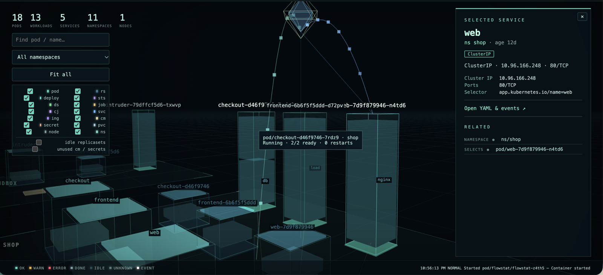

# kubectl skyline

[](https://github.com/zdk/kubectl-skyline/releases/latest)
[](https://github.com/zdk/kubectl-skyline/actions/workflows/ci.yml)
[](https://github.com/kubernetes-sigs/krew-index/blob/master/plugins/skyline.yaml)
[](LICENSE)

## See your cluster as a 3D city

`kubectl skyline` is a `kubectl` plugin.

It displays Namespaces as Floor plates, Workloads as towers.
Also, live events spark where they happen.



## Quick start

**Step 1:** Install with [krew](https://krew.sigs.k8s.io/)

```sh
kubectl krew install skyline
```

**Step 2:** Run it

```sh
kubectl skyline
```

**Step 3:** Explore

Your browser opens on the current context, with all namespaces shown.
Click any tower to see its relationships, YAML, events and logs.

## Features

### The city

- **Namespaces** are floor plates.
- **Workloads and pods** are towers, with one layer per container.
- **Services and ingresses** float above the pods they route to.
- **Live events** spark from the objects they touch.
- **CPU and memory** make pods glow, when `metrics.k8s.io` is available.

### Inspect

- Relationships, YAML, events and logs for any object.
- Search with `/`, then jump to a match.
- Works with your kubeconfig and the usual `kubectl` flags.

### Safe by default

- Read-only. It only lists and watches.
- Secret values are dropped as soon as they arrive. Only key names are kept.
- Serves on `127.0.0.1`. Other addresses need an explicit flag.

## Usage

```sh
kubectl skyline                    # current context, all namespaces
kubectl skyline -n shop            # one namespace
kubectl skyline --context staging  # another context
kubectl skyline --no-open          # print the URL instead of opening the browser
```

| Flag                   | Default          | What it does                                    |
| ---------------------- | ---------------- | ----------------------------------------------- |
| `--listen`             | `127.0.0.1:9393` | Address to serve the UI on                      |
| `--allow-non-loopback` | `false`          | Allow `--listen` on a non-loopback address      |
| `--no-open`            | `false`          | Do not open the browser                         |
| `--no-metrics`         | `false`          | Do not poll `metrics.k8s.io` for the glow       |
| `-A, --all-namespaces` | `false`          | Show all namespaces. Overrides `-n`             |

`--allow-non-loopback` exposes cluster details to the network without auth. Use it with care.

### Controls

| Input        | Action         |
| ------------ | -------------- |
| Drag         | Orbit          |
| Right-drag   | Pan            |
| Scroll       | Zoom           |
| Click        | Select         |
| `/`          | Search         |
| `f`          | Fit everything |
| `Esc`        | Clear selection |

### Permissions

Your kubeconfig needs `list` and `watch` on pods, workloads, services, ingresses, configmaps, secrets, PVCs, nodes, namespaces and events.

## Other ways to install

**Homebrew**

```sh
brew install zdk/tools/kubectl-skyline
```

**Install script**

```sh
curl -fsSL https://raw.githubusercontent.com/zdk/kubectl-skyline/main/install.sh | sh
```

| Variable      | What it does              | Default                               |
| ------------- | ------------------------- | ------------------------------------- |
| `VERSION`     | Pin a release             | latest                                |
| `INSTALL_DIR` | Where the binary is saved | `/usr/local/bin`, else `~/.local/bin` |

```sh
curl -fsSL https://raw.githubusercontent.com/zdk/kubectl-skyline/main/install.sh | VERSION=v0.1.4 sh
```

**Go**

```sh
go install github.com/zdk/kubectl-skyline/cmd/kubectl-skyline@latest
```

## License

MIT. three.js is vendored under its own MIT license.
